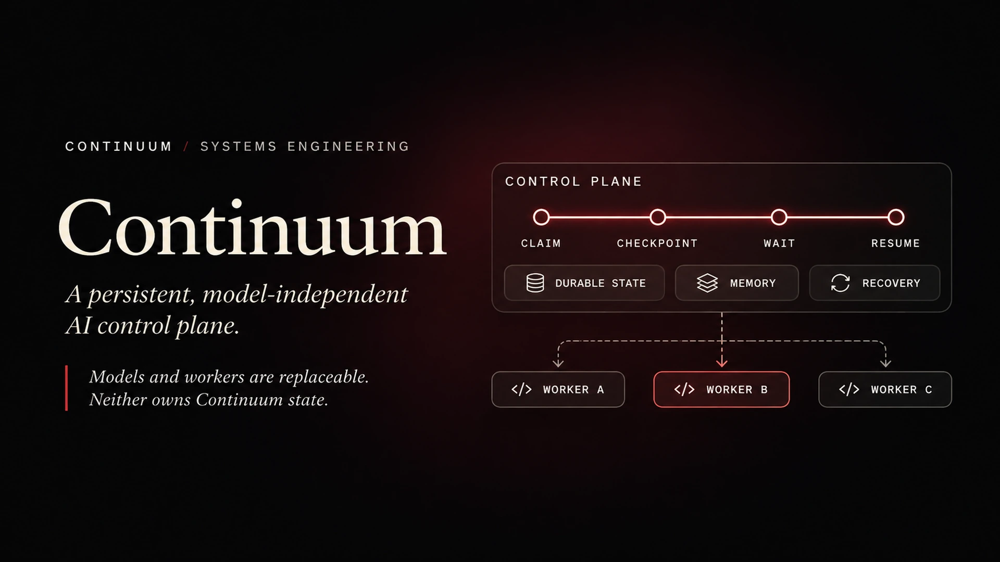
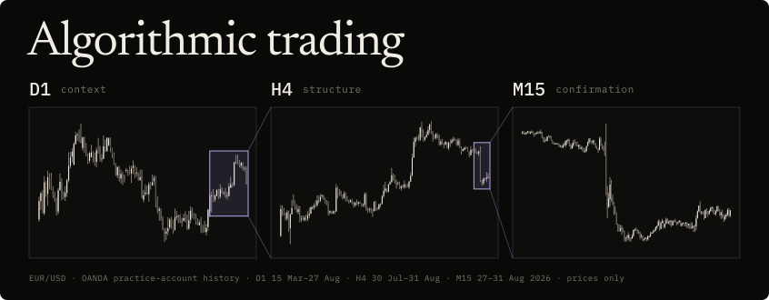

# ✦ Alp Murat Kıncak

**Software engineering · AI infrastructure · Mobile systems**  
Cornell University · Physics, Computer Science & Mathematics

## Building software across AI, mobile experiences, and reliable systems

I'm a Cornell student building full-stack applications, persistent AI infrastructure, and data-intensive software. I care most about systems that have to behave well under real-world constraints: asynchronous workflows, native mobile performance, stateful backends, and failure recovery.

**Currently building:** [Aftember](https://github.com/AlpKincak/aftember-showcase) · [Continuum](https://github.com/AlpKincak/continuum-showcase)  
**Areas of interest:** AI systems · mobile engineering · backend reliability · quantitative software

## Selected projects

<!-- The four images below are placeholders from this repository's existing artwork. -->
<!-- Replace each assets/frames/ image path when final screenshots are available. -->

<table>
  <tr>
    <td width="50%" valign="top">
      
      <h3><a href="https://github.com/AlpKincak/aftember-showcase">Aftember</a></h3>
      Mobile engineering · Backend systems
      
An event-first social camera built around shared memories. Native iOS capture, reliable media uploads, private shared albums, and the stateful workflows behind Rewinds.

      React Native · Swift · FastAPI · PostgreSQL
    </td>
    <td width="50%" valign="top">
      
      <h3><a href="https://github.com/AlpKincak/continuum-showcase">Continuum</a></h3>
      AI infrastructure · Distributed state
      
A model-independent personal AI control plane. Durable tasks, persistent memory, checkpoints, and recovery when execution workers fail.

      Python · FastAPI · PostgreSQL · Docker
    </td>
  </tr>
  <tr>
    <td width="50%" valign="top">
      
      <h3><a href="https://github.com/AlpKincak/trading_journal">Trading Journal</a></h3>
      Open source · Data applications
      
A local-first trading analytics app with CSV validation, read-only broker sync, risk metrics, and a Streamlit dashboard. Full source code is public.

      Python · Streamlit · SQLite
    </td>
    <td width="50%" valign="top">
      
      <h3><a href="https://github.com/AlpKincak/forex-trader-showcase">FX Research System</a></h3>
      Time-series analysis · Deterministic replay
      
A market structure research and observation system, with shared live/replay logic and explicit checks against look-ahead errors. No automated order execution.

      Python · SQLite · Web Push
    </td>
  </tr>
</table>

Aftember, Continuum, and the FX research system have private implementation repositories; their linked showcases document the work. Trading Journal is open source.

## Tools & technologies

**Languages**

**Frameworks & infrastructure**

**Data & machine learning**

