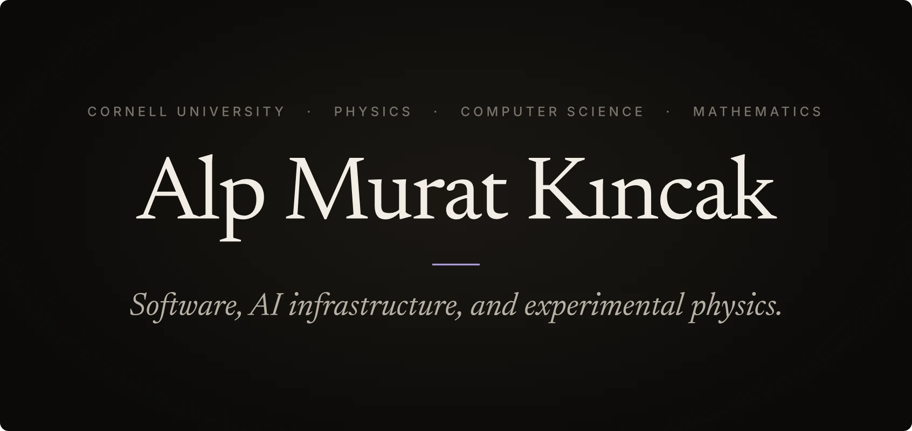
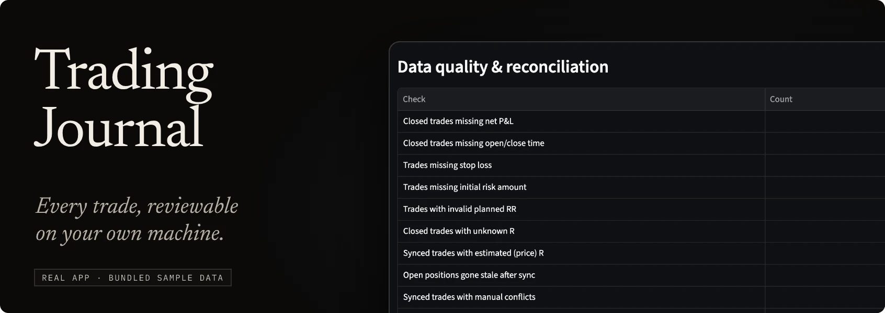
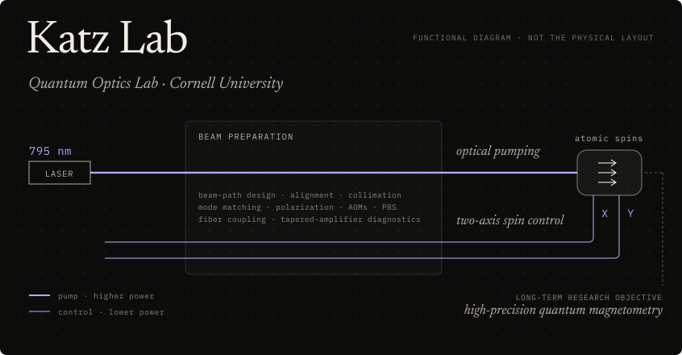

  

  Founder of <b>Aftember</b> · Creator of <b>Continuum</b> · Undergraduate researcher, <b>Katz Lab</b> 
  Physics, Computer Science &amp; Mathematics at Cornell University

 

**Aftember** · Founder & lead engineer 
A private social camera built around real-world Moments: Expo client, FastAPI, PostgreSQL, private media storage, and a durable state machine behind collaborative Rewinds. 
Screens are design renders, not device captures.

[Product & engineering showcase →](https://github.com/AlpKincak/aftember-showcase)

 

**Continuum** · Creator · formerly Jarvis 
A persistent, model-independent control plane for personal AI. It owns memory, tasks and their append-only history; models and agent workers are replaceable and never own that state. Above is one subsystem, durable task execution: work runs in leased segments that end in committed checkpoints, so after a worker dies the next attempt resumes from the last checkpoint and only the unfinished segment is redone.

[Technical showcase →](https://github.com/AlpKincak/jarvis-showcase)

 

**Algorithmic trading** · Time-series research 
A deterministic multi-timeframe FX research system covering market structure, points of interest, liquidity and lower-timeframe confirmation. The same pipeline runs in live observation and in replay, with checks for look-ahead errors. Research only; it never places orders.

[Technical showcase →](https://github.com/AlpKincak/forex-trader-showcase)

 

**Trading Journal** · Open source 
An open-source, local-first trade journal: CSV import and read-only TradeLocker sync into SQLite, data-quality checks, risk analytics and a Streamlit dashboard. Analysis only, with no order placement. 
Screenshot of the real app on its bundled sample data.

[Source code →](https://github.com/AlpKincak/trading_journal)

 

**Katz Lab** · Undergraduate researcher, Prof. Or Katz's Quantum Optics Lab, Cornell 
I build and optimize the 795 nm optical-pumping system for an atomic spin-control platform: beam-path design, alignment, collimation and mode matching, polarization control with AOMs and PBS optics, fiber coupling, tapered-amplifier diagnostics and stabilization, and a lower-power two-channel (X/Y) spin-control path. The platform's long-term goal is high-precision quantum magnetometry. 
Functional diagram, not the optical layout.

 

  <a href="https://www.linkedin.com/in/alp-murat-k%C4%B1ncak-a97052304/">LinkedIn</a> · <a href="https://github.com/AlpKincak?tab=repositories">All repositories</a> 
  Production code for Aftember, Continuum and the FX research system is private; the showcases document their architecture. trading_journal is fully public.

